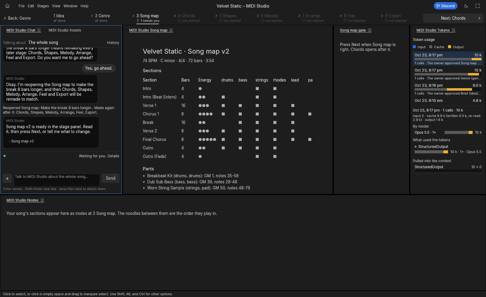
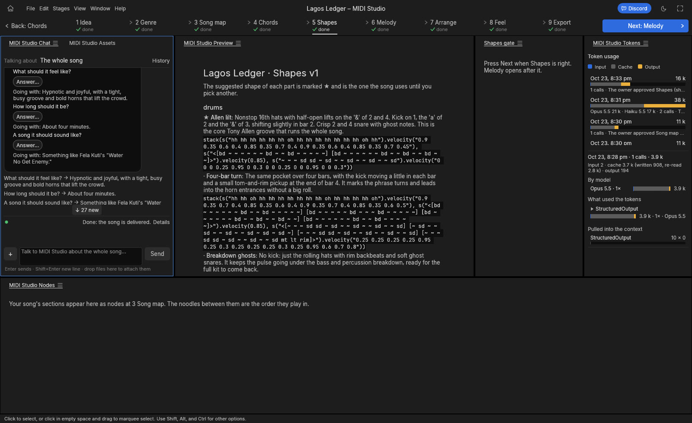
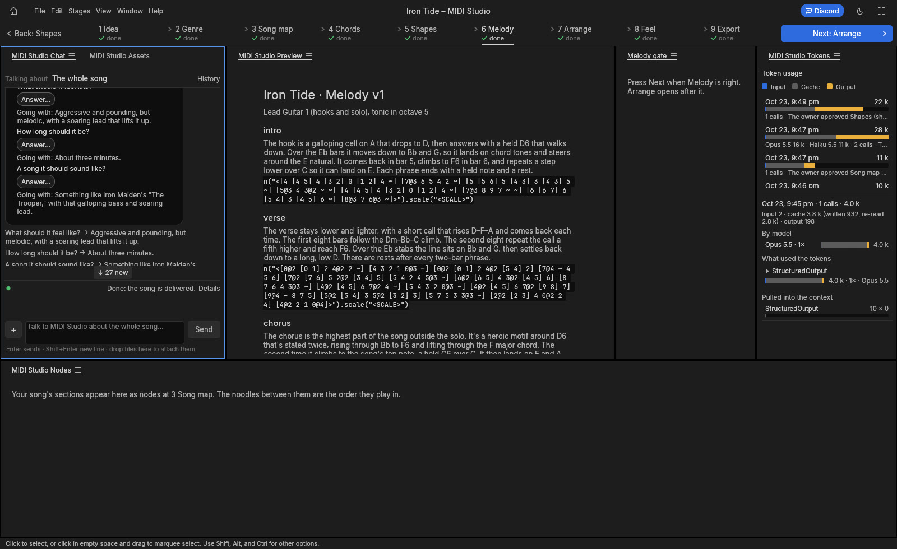

<h1 align="center">Mortiflix Music</h1>

<p align="center">
  <b>Make a song with AI, one stage at a time, and take it home as MIDI.</b>
</p>

<p align="center">
  Idea, genre, song map, chords, shapes, melody, arrange, feel and export, with a gate you pass at every step.<br>
  The AI makes the musical decisions; the app writes and checks every note.
</p>

<p align="center">
  <a href="#license-and-credits"></a>
  
  <a href="https://discord.gg/5xCB666rYk"></a>
</p>

<p align="center"></p>

This is the new Mortiflix Music. It replaces the earlier web app, which still lives on the
[`legacy`](../../tree/legacy) branch.

## Hear what it makes

Sixteen songs, each from a one-line idea, each in a different genre, made start to finish in the app while it was
being tested (2026-10-24). The previews are a plain General MIDI render, so the instruments are rough: the MIDI is the
product. Load it into your DAW and put your own sounds on it.

| Song | Genre | BPM | Key | Meter | Length | Preview | MIDI |
|---|---|---|---|---|---|---|---|
| **Low Tide Social** | Late-90s Chicago deep house | 121 | A minor | 4/4 | 2:55 | [▶ listen](https://github.com/GTKottman/mortiflix-music-oss/releases/download/examples-v1/low-tide-social-preview.mp3) | [low-tide-social.mid](examples/low-tide-social.mid) |
| **Paper Lanterns** | Lo-fi hip-hop | 78 | E♭ major | 4/4 | 2:28 | [▶ listen](https://github.com/GTKottman/mortiflix-music-oss/releases/download/examples-v1/paper-lanterns-preview.mp3) | [paper-lanterns.mid](examples/paper-lanterns.mid) |
| **Brass Tacks** | 70s horn funk | 106 | F dorian | 4/4 | 3:01 | [▶ listen](https://github.com/GTKottman/mortiflix-music-oss/releases/download/examples-v1/brass-tacks-preview.mp3) | [brass-tacks.mid](examples/brass-tacks.mid) |
| **Saudade Avenue** | Bossa nova | 126 | F major | 4/4 | 2:59 | [▶ listen](https://github.com/GTKottman/mortiflix-music-oss/releases/download/examples-v1/saudade-avenue-preview.mp3) | [saudade-avenue.mid](examples/saudade-avenue.mid) |
| **Third Floor Waltz** | Jazz waltz (piano trio + vibes) | 160 | B♭ major | 3/4 | 3:00 | [▶ listen](https://github.com/GTKottman/mortiflix-music-oss/releases/download/examples-v1/third-floor-waltz-preview.mp3) | [third-floor-waltz.mid](examples/third-floor-waltz.mid) |
| **Night Bus 174** | Liquid drum & bass | 174 | F minor | 4/4 | 3:30 | [▶ listen](https://github.com/GTKottman/mortiflix-music-oss/releases/download/examples-v1/night-bus-174-preview.mp3) | [night-bus-174.mid](examples/night-bus-174.mid) |
| **Harbour Steps** | Roots reggae (one-drop) | 72 | G major | 4/4 | 3:00 | [▶ listen](https://github.com/GTKottman/mortiflix-music-oss/releases/download/examples-v1/harbour-steps-preview.mp3) | [harbour-steps.mid](examples/harbour-steps.mid) |
| **Velvet Static** | Trip hop | 74 | C minor | 4/4 | 3:54 | [▶ listen](https://github.com/GTKottman/mortiflix-music-oss/releases/download/examples-v1/velvet-static-preview.mp3) | [velvet-static.mid](examples/velvet-static.mid) |
| **Lagos Ledger** | Afrobeat | 110 | D dorian | 4/4 | 3:56 | [▶ listen](https://github.com/GTKottman/mortiflix-music-oss/releases/download/examples-v1/lagos-ledger-preview.mp3) | [lagos-ledger.mid](examples/lagos-ledger.mid) |
| **Crossroads Motel** | Slow Chicago blues | 70 | E mixolydian | 4/4 | 2:58 | [▶ listen](https://github.com/GTKottman/mortiflix-music-oss/releases/download/examples-v1/crossroads-motel-preview.mp3) | [crossroads-motel.mid](examples/crossroads-motel.mid) |
| **Concrete Bloom** | Berlin techno | 130 | F minor | 4/4 | 3:56 | [▶ listen](https://github.com/GTKottman/mortiflix-music-oss/releases/download/examples-v1/concrete-bloom-preview.mp3) | [concrete-bloom.mid](examples/concrete-bloom.mid) |
| **Glass Cathedral** | Cinematic orchestral | 72 | D minor | 4/4 | 2:27 | [▶ listen](https://github.com/GTKottman/mortiflix-music-oss/releases/download/examples-v1/glass-cathedral-preview.mp3) | [glass-cathedral.mid](examples/glass-cathedral.mid) |
| **Morning Glory Road** | Gospel | 108 | A♭ major | 4/4 | 2:58 | [▶ listen](https://github.com/GTKottman/mortiflix-music-oss/releases/download/examples-v1/morning-glory-road-preview.mp3) | [morning-glory-road.mid](examples/morning-glory-road.mid) |
| **Porch Light Waltz** | Country waltz | 92 | G major | 3/4 | 2:56 | [▶ listen](https://github.com/GTKottman/mortiflix-music-oss/releases/download/examples-v1/porch-light-waltz-preview.mp3) | [porch-light-waltz.mid](examples/porch-light-waltz.mid) |
| **Satellite Heart** | Synth-pop / K-pop | 122 | E major | 4/4 | 3:09 | [▶ listen](https://github.com/GTKottman/mortiflix-music-oss/releases/download/examples-v1/satellite-heart-preview.mp3) | [satellite-heart.mid](examples/satellite-heart.mid) |
| **Iron Tide** | Heavy metal | 160 | D minor | 4/4 | 2:42 | [▶ listen](https://github.com/GTKottman/mortiflix-music-oss/releases/download/examples-v1/iron-tide-preview.mp3) | [iron-tide.mid](examples/iron-tide.mid) |

Each song also comes out as one MIDI file per part and one per section, with a cue sheet for FL Studio and REAPER.
A song costs about 70,000-100,000 tokens of your own Claude plan, and about six minutes, from idea to MIDI.

## How it works

Nine stages, in order. Each one ends at a gate: you read it, play it, and press Next (or tell the chat what to change),
and nothing of the next stage is made before you do.

| # | Stage | What you get |
|---|---|---|
| 1 | **Idea** | Four questions in the chat (what it's for, the feel, how long, what it should sound like), each with a suggested answer. Out comes a one-page brief. |
| 2 | **Genre** | How the genre is really made: tempo range, keys, drums, bass, harmony, instruments, song form, signature moves, sources. |
| 3 | **Song map** | The sections in order with their bars and energy, the parts, tempo, key and meter. |
| 4 | **Chords** | The progression for each kind of section. |
| 5 | **Shapes** | Short loops for each part (drums, bass, keys, arps…), a few options each. The suggested one plays most and a second one lifts the big sections (picking them yourself is coming; for now, ask the chat). |
| 6 | **Melody** | The lead line over the chords. |
| 7 | **Arrange** | The whole song, built part by part from the shapes and the melody. |
| 8 | **Feel** | Velocity, swing, a human timing drift and drum fills into the sections that lift. |
| 9 | **Export** | The MIDI files, a cue sheet and a General MIDI preview. |

- **The AI decides, code writes the notes.** Each stage is one small AI call (no long sessions); Arrange, Feel and
  Export use no AI at all. Every note is plain [Strudel](https://strudel.cc): harmony parts play chord tones by index,
  melodies play scale degrees, so pitch is right by construction.
- **Every stage is checked before you see it:** notes in the key and on the chord, parts in their instrument's range,
  no silent sections, the song the length you asked for, not the same key and tempo as your recent songs. A stage that
  fails a check goes back to the AI with only the problems.
- **Change anything, any time.** Tell the chat what to change on the stage you're looking at. Changing a stage you
  already approved tells you which later stages it remakes and asks first.
- **Tokens are counted** per call and shown per song; a song stops at its budget (`midiTokenBudget`) with a Resume
  button.

<p align="center">
  
  
</p>

## Download

Installers are on the [Releases](../../releases) page:

- **Windows**: the `.msi` installer.
- **Linux**: the `.tar.gz` (run `./install.sh` inside; no sudo, installs into `~/.local`), plus `.deb`, `.rpm` and AppImage builds.
- **macOS**: coming soon.

Everything it needs ships inside: its service, Node, Strudel, ffmpeg and a General MIDI soundfont. On Linux the
preview uses your system's FluidSynth (`sudo apt install fluidsynth`); without it you still get every MIDI file.
The AI is your own [Claude Code](https://claude.com/claude-code) (your plan, no API key needed): the first start
links it.

Mortiflix Music installs beside [Mortiflix Studio](https://mortiflix.com) without clashing: its own name, app id
(`com.mortiflix.music`), settings and songs folder (`~/MortiflixMidi`).

## Build from source

The app is this repository (Rust); its service is the [`service`](../../tree/service) branch (Node).

```sh
git clone https://github.com/GTKottman/mortiflix-music-oss
git clone -b service https://github.com/GTKottman/mortiflix-music-oss mortiflix-music-service
(cd mortiflix-music-service && npm ci && node bin/mortiflix setup music)   # Strudel for the stages
cd mortiflix-music-oss
MFX_SERVICE="$PWD/../mortiflix-music-service" cargo run --release -p mortiflix-studio
```

Packaging: `packaging/linux/package.sh` and `packaging/windows/package.ps1` (they bundle the service from
`MFX_SERVICE_SRC` / `MFX_SERVICE_REF`). The same code also runs Mortiflix Studio (`MFX_PRODUCT=video`).

## License and credits

Mortiflix Music (this app) is dual-licensed under [MIT](LICENSE-MIT) or [Apache-2.0](LICENSE-APACHE), at your option.
Copyright (c) 2026 ArtCraft Team and the upstream contributors; the required notices are in [NOTICE](NOTICE).*

Bundled fonts, icons, images and other assets keep their own open licenses; each one is listed
with its author, source and license in [ATTRIBUTION.md](ATTRIBUTION.md). Builds made with
[craft-fonts](https://github.com/storytold/craft-fonts) (all official releases) also embed its fonts
(OFL-1.1), listed in its [ATTRIBUTION.md](https://github.com/storytold/craft-fonts/blob/main/ATTRIBUTION.md).

**The bundle** the installers ship beside the app is a separate program with its own licences: the Mortiflix service (AGPL-3.0, the [`service`](../../tree/service) branch), Node.js, Strudel (AGPL-3.0), ffmpeg (GPL), the GeneralUser GS soundfont by S. Christian Collins (its own free licence) and, on Windows, FluidSynth (LGPL-2.1); each licence is in the bundle's `LICENSES/` folder.

**Footage and music in the editor's screenshots elsewhere in the docs:** NASA's Apollo 11 film and television footage from [images.nasa.gov](https://images.nasa.gov) (launch, Launch Control Center, lunar surface and recovery) and the Apollo 11 air-to-ground voice transcript, all US Government works in the public domain (NASA does not endorse this project); *Night of the Living Dead* (1968), *Carnival of Souls* (1962) and *Charade* (1963), all in the US public domain; *Earth Views from the ISS* by NASA; Chopin's Nocturne Op. 48 No. 1 and Ballade No. 1, performed for Musopen and released under CC0. The media itself is not in this repository. Sources and details for every asset are in [ATTRIBUTION.md](ATTRIBUTION.md).

The app is an independent implementation. It contains no Adobe code, icons, images, presets or LUTs, and no GPL or LGPL code; every icon is drawn in code and every asset is openly licensed and attributed ([AGENTS.md](AGENTS.md)), apart from the ArtCraft name and logos, which are trademarks of the ArtCraft Team used under [`docs/brand/LICENSE-brand.txt`](docs/brand/LICENSE-brand.txt). ffmpeg is used only as an external test oracle.*

The ArtCraft name, wordmark and logos in [`docs/brand/`](docs/brand/) are trademarks of the
ArtCraft Team and are not covered by this license. They may be used only unmodified, and only as
part of this repository and Mortiflix Music, under [`docs/brand/LICENSE-brand.txt`](docs/brand/LICENSE-brand.txt).
Forks and modified versions must remove them.*

<sub>Adobe, Photoshop, Illustrator, Premiere Pro, Lightroom, Acrobat, After Effects and InDesign are trademarks or registered trademarks of Adobe Inc. in the United States and/or other countries. Mortiflix Studio is an independent, open-source project and is not affiliated with, sponsored by or endorsed by Adobe Inc.; these names are used only to describe the workflows it is compatible with.</sub>

<br>

---

<sub>* = built off the back of ArtCraft</sub>
