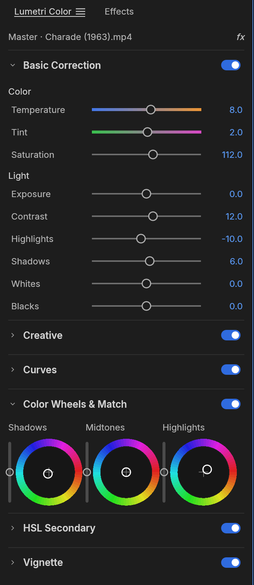

<h1 align="center">Mortiflix Studio</h1>

<p align="center">
  <b>Make a video with AI, one stage at a time, and finish it in a full video editor.</b>
</p>

<p align="center">
  Script, voice, style frames, transitions, animatic, music, edit and render, with a gate you pass at every step.<br>
  The editor is an open-source, clean-room take on the Adobe Premiere Pro workflow in pure Rust*.
</p>

<p align="center">
  <a href="#license-and-credits"></a>
  
  
  <a href="#status"></a>
</p>

<p align="center">
  <a href="https://discord.gg/5xCB666rYk"></a>
</p>

<p align="center">
  <a href="https://mortiflix.com"><b>Mortiflix Studio on mortiflix.com</b></a> ·
  <a href="https://discord.gg/5xCB666rYk">Mortiflix Discord</a>
</p>

<br>

<p align="center">
  
</p>

<p align="center"><sub><i>Apollo 11 - Tranquility</i>: a three-minute documentary edit of NASA's 1969 launch, landing and moonwalk film, with subtitles from the mission transcript. Every frame in these screenshots comes from public-domain footage, decoded, composited and graded by Mortiflix Studio's own code.*</sub></p>

> [!NOTE]
> **Mortiflix is for anyone who makes videos.** Explainers, documentaries, music, games &mdash;
> if you make things, you're one of us. **[Come say hi on Discord](https://discord.gg/5xCB666rYk).**

<p align="center">
  <a href="#mortiflix">Mortiflix</a> ·
  <a href="#edit">Edit</a> ·
  <a href="#color">Color</a> ·
  <a href="#effects-and-motion">Effects</a> ·
  <a href="#audio">Audio</a> ·
  <a href="#titles-and-captions">Titles</a> ·
  <a href="#formats-and-codecs">Formats</a> ·
  <a href="#export">Export</a> ·
  <a href="#interchange">Interchange</a> ·
  <a href="#built-for-agents">Agents</a> ·
  <a href="#get-started">Get started</a> ·
  <a href="#downloads">Downloads</a> ·
  <a href="#documentation">Docs</a> ·
  <a href="#status">Status</a>
</p>

<br>

## Mortiflix

You tell Mortiflix what the video is about. The AI writes it, voices it, draws it, animates it and scores it, but it works one stage at a time: each stage ends in a **gate**, and nothing after a gate is recorded, drawn or rendered until you pass it. You stay in the loop the whole way, and every part of the work has its own corner on screen.

### The steps

**1. New project.** Pick a preset (Explainer video, Dry docs, or one of your own) and write the idea in your words. Then set as much or as little as you like; anything you leave empty, the AI picks:

- **Length and shape:** how long the video runs and the screen it's made for (wide, vertical or a custom shape).
- **Narration:** narrated, or told with on-screen text and music only; the voice and how it's spoken.
- **Music:** an original score, music like a song you drop in (studied for its feel, tempo and instruments, never copied), or no music; instruments to use or leave out; a tempo fitted to the cuts or a fixed BPM.
- **Pictures to match and assets:** pictures, logos, footage, sound, music, fonts and documents, each with a note on how to use it. Mortiflix sees them from the first step.
- **Presets** are yours to change: save your own, with skills (a folder with a `SKILL.md`) copied in.

**2. The brief.** Mortiflix Chat reads the idea and asks what it needs to know. Questions never block: it waits for your answers, shows its suggestion for each, and you can take the suggestion as is.

**3. Script.** The script appears in the Mortiflix Script box scene by scene as it's written. Change the words of any line, delete a line or bring it back (Ctrl+Z, even after saving), and OK each scene. Saving only remakes the voice lines and shots that used the words you changed. The **Script gate** passes when the AI has finished, every scene has its words, every change is saved and every scene is OK'd.

**4. Voice.** The script is read aloud, one voice line per scene, grouped under its scene with Play scene. A line is recorded as soon as you OK its scene. Each line shows how it's made: an AI voice, record yourself, or import a recording. You check each scene's voice before any picture is made.

**5. Style frames.** Pick a style pack from the look menu (anything you change applies to this video only), then press Make the style frames. They're drawn in the voice's mood: the colours, characters and type of the video, not the shots yet. Check off the ones you want.

**6. Transitions.** Pick a transition pack (or use the transitions library), then Make the transitions. Every cut between scenes gets its transition, drawn in the look you checked off. The cuts board shows each cut as scene before, transition, scene after: OK it, ask for a Fix, or change it.

**7. Animatic.** Pick the motion (a motion pack, plus rule packs the AI follows in every step from here on), then Animate with this. Every scene is animated and timed to the voice, in the look, cut with your transitions. In **Mortiflix Nodes** every shot is a node, chained in order with transition nodes between them: OK a shot, ask for a Fix, or Cut it. Each note goes out at once, so new versions are made while you keep walking the film, and old versions are kept so you can go back.

**8. Music.** The music is written to the animatic's timing in Strudel, with its MIDI under the animatic. You hear themes first and the one you use becomes the music's main idea. The soundtrack mixes the voice, the music (kept under the voice while it speaks) and sound effects matched to the cuts.

**9. Edit.** Bring it into Edit: everything you OK'd is placed on one timeline (shots, voice, music, captions and a marker per scene) in the full video editor below. Or skip straight to the render.

**10. Render.** Pick where the video goes and render it in the Export tab. Renders on your PC run one at a time so they never fight for memory; the best-quality copy is Apple ProRes 422 HQ with 24-bit sound. Posting goes out through Upload-Post or your own Postiz.

### Around the steps

- **Mortiflix Chat:** talk to Mortiflix about the whole video or one scene, at any stage, and attach files to the conversation.
- **Stage bar:** the eight stages (Script · Voice · Style frames · Transitions · Animatic · Music · Edit · Render) across the top, each with its status. Stages past a gate you haven't passed stay grey until you pass it.
- **Gate panel:** every stage lists what has to be true before you move on, with a count of what's made and checked off.
- **Packs:** styles, transitions, motion, rules, music and voices come as packs, picked before anything is made. Get more from the Home screen.
- **Mortiflix Tokens:** see what every Claude run in your project used (input, cache and output) and the voice characters recorded.
- **Your own AI:** Mortiflix runs the AI through your own Claude Code on your own PC.

The editor underneath, everything from here down, is marked with a *.

<br>

Mortiflix Studio is a non-linear editor for people who know Premiere: the same panels, workspaces, tools and shortcuts, so your hands already know where everything is. Underneath, it is new from the bitstream up. The H.264, HEVC, ProRes and AAC codecs are our own, written in Rust from the public specifications. A GPU compositor works in linear light. Frame math runs on exact integer time, so edits never drift. And every action in the app is a command that an AI agent can drive as precisely as you can.*

<br>

## Edit*

<p align="center">
  
</p>

<p align="center"><sub>The Assembly workspace, cutting a trailer for <i>Night of the Living Dead</i> (1968) with an insert from <i>Carnival of Souls</i> (1962).</sub></p>

**A timeline you already know.** Source and Program monitors, bins with thumbnails, a multi-track timeline with patch and target buttons, sync locks and linked selection. The Editing, Assembly, Color, Effects and Audio workspaces are all there, and every panel docks wherever you want it.

- **Three-point editing.** Mark In and Out in the Source monitor, then insert (`,`) or overwrite (`.`) onto the patched tracks. Lift (`;`) and extract (`'`) take ranges back out.*
- **Every trim.** Ripple, roll, slip, slide, rate stretch and razor tools. Trim mode selects edit points as ripple, roll or trim, nudges them a frame at a time (`⌥←` `⌥→`, ×5 with `⇧`), toggles the trim type with `⌃T` and extends them to the playhead with `E`. `Q` and `W` ripple-trim to the playhead. The **Trim Monitor** shows both sides of the edit, and **dynamic trimming** trims live while it plays: `L` forward, `J` back, `K` to stop and commit as one undo step.*
- **Exact time.** Every edit is computed on integer ticks: 254,016,000,000 per second, which divides evenly by every common frame rate and sample rate. 23.976, 29.97 drop-frame and 59.94 are exact, not approximate.*
- **The details pros rely on.** Markers with colours, names and durations; export sequence review notes with **Markers ▸ Export Markers as CSV…**; add edit (`⌘K`) on one or all tracks; nesting; copy, paste and paste insert; ripple delete and close gap; snapping; unlimited undo with a History panel.*
- **Your keys.** A Keyboard Shortcuts editor (`⌥⌘K`) with a drawn keyboard, panel-specific shortcuts, conflict warnings and presets for Mortiflix Studio, Premiere Pro, Final Cut Pro and Avid key layouts.*
- **Never lose work.** Saves are atomic, auto-save keeps a rolling set of versions, and a crash-recovery journal written about a second after each edit brings back unsaved changes after a crash or power cut.*

<p align="center">
  
</p>

<p align="center"><sub>Up close: dissolves, an insert on V2, the score on A2, coloured markers, and the loudness meters on the right.</sub></p>

<br>

## Color*

<p align="center">
  
</p>

<p align="center"><sub>The Color workspace on <i>Charade</i> (1963), with live scopes beside the Program monitor.</sub></p>

**A complete color grading panel**, in the order a colourist works:

- **Basic Correction:** temperature and tint, exposure, contrast, highlights, shadows, whites, blacks, saturation.*
- **Creative:** eight built-in looks with an intensity control, plus faded film, sharpen and vibrance. The looks are colour transforms written in code, not LUT files.*
- **Curves:** an RGB curve editor with monotone-cubic interpolation (no overshoot), and hue vs saturation, hue vs hue, hue vs luma, luma vs saturation and saturation vs saturation.*
- **Color Wheels:** shadow, midtone and highlight wheels, each with its own lightness control.*
- **HSL Secondary:** key a colour by hue, saturation and luma, view the key as a matte, and correct only what you selected.*
- **Vignette:** amount, midpoint, roundness and feather.*

<table>
  <tr>
    <td width="34%" valign="top" align="center">
      <br>
      <sub><b>The Lumetri Color panel.</b> Basic Correction, Color Wheels and every other section, each with its own on/off switch.</sub>
    </td>
    <td width="66%" valign="top" align="center">
      <br>
      <sub><b>Scopes that tell the truth.</b> The waveform and vectorscope are computed from the graded frame. All grading happens in linear light, in 32-bit float.</sub>
    </td>
  </tr>
</table>

<br>

## Effects and motion*

<p align="center">
  
</p>

<p align="center"><sub>NASA's <i>Earth Views from the ISS</i> with a look applied, and the Effects browser open on the dissolves.</sub></p>

- **Premiere 26's full Video Effects bin (93 effects in 16 folders), the Legacy bin and the obsolete effects old projects use, plus around 30 transitions.** Blurs (Bokeh, Focus, Compound), keys (Ultra Key, Track Matte), distortions (Corner Pin, Turbulent Displace, Warp Stabilizer), Lights & Glows, Immersive Video (VR) effects on equirectangular footage, Posterize Time, Echo and more. Cross dissolve, dip to black or white, film dissolve, wipes, irises, pushes, slides, zooms, page peel, cube spin and more.*
- **Motion and opacity on every clip:** position, scale, rotation, anchor point and anti-flicker, plus 26 blend modes.*
- **Keyframes like Premiere's:** linear, Bezier, auto and continuous Bezier, hold, ease in and ease out. Effect Controls shows a keyframe lane for every parameter under a time ruler with the playhead's handle, and each animated parameter opens into **value and velocity graphs** with draggable influence handles. Effect Controls and the Properties panel share the keyframe navigator (◀ ◆ ▶): add or remove the keyframe at the playhead, step to the previous or next one.*
- **A GPU compositor** built on wgpu (Metal, Vulkan, DirectX 12, WebGPU). It samples YUV straight from the decoder with footprint supersampling and blends in linear light. A CPU path renders the same frames, and the two are tested against each other.*

<p align="center">
  
</p>

<p align="center"><sub>An eased push-in on the title card: the value graph, the velocity graph and the Bezier influence handle.</sub></p>

<br>

## Audio*

- **Loudness meters to broadcast standards.** Momentary, short-term and integrated loudness and true peak to ITU-R BS.1770 and EBU R128, alongside the peak meters. Our integrated reading matches ffmpeg's `ebur128` filter to the tenth of a LU.*
- **Clip effects on our own DSP library:** parametric EQ, high-pass, low-pass and band-pass filters, dynamics, a true-peak limiter, delay, reverb, DeNoise, DeHummer, invert and pitch shift. Parameters can be keyframed. Effects stay continuous across scrubbing, playback and export, with latency compensated.*
- **Audio Track Mixer and Audio Clip Mixer:** faders, pan, mute, solo, five insert slots per track (pre- or post-fader), sends, submixes and a Mix track, all sample-accurate and latency-compensated. 24 tracks with three effects each mix about six times faster than real time on one core.*
- **Automation like a console:** Read, Latch, Touch and Write modes recorded live from the mixer during playback, shown and edited as track keyframes on the timeline. Plus the Audio Gain dialog (set, adjust, normalize) and constant-power crossfades.*
- **Audio-clock playback.** The sound card is the master clock, so picture follows sound and never the other way round.*

<br>

## Titles and captions*

- **A real text engine:** OpenType shaping with kerning and ligatures, bidirectional text, line breaking, tracking and leading, drawn in linear light and sharp at any scale or rotation.*
- **Type, Shape and Pen tools** on the Program monitor: click to type, edit with a caret and selection, drag out rectangles, ellipses and paths. Graphic clips hold text and shape layers with fill, strokes, background and shadow, all keyframable, and edited in the Properties panel.*
- **Captions:** caption tracks in Subtitle, CEA-608, CEA-708 and Teletext formats; import and export SRT, WebVTT and SCC with frame-exact timing; edit captions in the Text panel and burn them into exports.*
<br>

## Formats and codecs*

No FFmpeg inside. The video codecs, AAC, Opus and the containers are our own Rust code, implemented from the public ITU-T, ISO and IETF specifications and tested frame by frame against ffmpeg as an external oracle.

| | Decode | Encode | Notes |
|---|:---:|:---:|---|
| **H.264 / AVC** | ✓ | ✓ | Decoder bit-exact on 37+ streams, 500–600 fps at 1080p. Encoder: High, Main and Baseline profiles, CABAC, B-frames, CRF/CBR/VBR/2-pass |
| **HEVC / H.265** | ✓ | | Main and Main 10, bit-exact on 41 streams (tiles, WPP, PCM, long-term references), about 225 fps at 1080p |
| **Apple ProRes** | ✓ | ✓ | Decodes 422 Proxy to 4444 XQ; export writes 422 HQ |
| **AAC-LC** | ✓ | ✓ | |
| **VP8** | ✓ | | Every coding tool, bitstream versions 0–3, hidden altref frames, alpha layer of transparent WebM; bit-exact with libvpx on its published VP8 test vectors; in WebM/Matroska and MP4 |
| **VP9** | ✓ | | Profiles 0–3, 8/10/12-bit, 4:2:0 to 4:4:4, tiles and superframes; bit-exact on 50+ streams; in WebM/Matroska and MP4 |
| **Opus** | ✓ | | SILK, CELT, hybrid and multistream surround; range-exact on every RFC 8251 conformance vector; in WebM/Matroska and MP4 |
| **AV1** | ✓ | | Main profile, 8/10-bit 4:2:0 and monochrome, every coding tool incl. film grain, superres and spatial layers; bit-exact with libdav1d on the libaom vectors tested; in MP4 and WebM/Matroska |
| **DNxHD / DNxHR** | ✓ | ✓ | All SMPTE ST 2019-1 CIDs (LB to 444, 8/10/12-bit); export writes DNxHR in MOV |
| **MJPEG, PCM** | ✓ | ✓ | |
| **MP3, FLAC, ALAC, Vorbis** | ✓ | | Via the [symphonia](https://github.com/pdeljanov/Symphonia) crate (MPL-2.0) for now, to be replaced by our own |
| **MP4 / MOV** | ✓ | ✓ | Fragmented MP4, edit lists, timecode tracks |
| **Matroska / WebM** | ✓ | | Lacing, Cues, header stripping, HDR colour metadata |
| **AVI** | ✓ | | AVI 1.0 and OpenDML (files past 1 GB); Motion JPEG, H.264, HEVC and uncompressed RGB / YUV with PCM, MP3, MP2 or AC-3. DivX / Xvid and DV not yet |
| **Stills** | ✓ | ✓ | Import PNG, JPEG, GIF, WebP, TIFF and BMP (animated GIF and APNG as clips, with transparency); export PNG sequences and animated GIF |

Also imported: MPEG-2 / MPEG-1 video, AC-3, MP2, MXF (OP1a / OP-Atom), MPEG transport and program streams (AVCHD, broadcast, DVD), Ogg and image sequences. Not yet: AV1 export, camera RAW, E-AC-3. Hardware decoding works on macOS (VideoToolbox), Windows (Media Foundation) and, for H.264 and HEVC, Linux (VA-API); H.264 export can use NVIDIA's encoder on Windows and Linux (opt-in), and H.265 (HEVC Main, 8-bit) export works through it (NVENC on Windows, VideoToolbox on macOS) ([#30](https://mortiflix.com)).

<br>

## Export*

<p align="center">
  
</p>

<p align="center"><sub>Export mode, set to write the trailer as H.264 MP4.</sub></p>

- **H.264 MP4 with AAC, using our own encoders.** A 6-second 960×540 render takes 1.3 seconds and decodes in ffmpeg without a single warning, with strict error detection on.*
- **Also:** Apple ProRes 422 HQ and Motion JPEG in QuickTime, MXF OP1a and Avid-style OP-Atom (DNxHR, ProRes or H.264 with PCM and start timecode), PNG sequences, animated GIF and WAV.*
- **Background jobs** with progress and cancel, so you keep editing while it renders.*
- **Render previews:** the render bar marks segments green, yellow or red; rendered previews are cached by content, so an edit only invalidates what it touches and undo brings the green back.*

<br>

## Interchange*

Move timelines between Mortiflix Studio and every other editor:

- **Final Cut Pro 7 XML (xmeml):** the format Premiere and DaVinci Resolve exchange. It carries nested sequences, transitions, generators, Motion, Opacity, Time Remap and audio levels, with keyframes.*
- **FCPXML 1.9–1.11:** the spine, connected clips as lanes, transitions, retiming and compound clips.*
- **OpenTimelineIO:** the open interchange format of the film industry, round-tripping every Mortiflix Studio detail through `metadata.mortiflix`.*
- **CMX 3600 EDL:** the oldest format still in use, with drop-frame timecode, dissolves, wipes, speed changes (`M2`) and one EDL per track.*
- **AAF (Edit Protocol):** for Avid Media Composer and Pro Tools. Video and audio tracks, dissolves and dips, clip volume with keyframes, markers and source timecode; audio embedded or as separate WAV / AIFF files, trimmed with handles, with clip effects rendered in and broken out to mono, plus an optional video mixdown. Import reads AAF back, extracting embedded audio.*
- **OMF 2.0:** the audio-post handoff: the audio tracks with crossfades and gain, sample-accurate, with the audio encapsulated or alongside.*

Import merges the document's bins, media and sequences into your project as one undoable step, and links each media file it finds on disk.

<br>

## Built for agents*

Every menu item, button, slider and drag in Mortiflix Studio is a **command** with an id, typed parameters and an enabled state. There are more than 650 engine commands (`mortiflix-studio-cli commands` lists them), with the rest of Premiere's catalogue on the way. The UI, the CLI, a JSON control channel and an **MCP server** all dispatch the same commands, so Claude or any agent can cut, trim, grade, mix and export exactly the way a person does. The UI can also be driven at the level of mouse and keyboard: every widget has an automation id, and agents can click, drag, type and take screenshots.

```jsonc
// over the control channel (JSON lines on TCP) or as MCP tool calls
{"method": "engine.execute", "params": {"command": "timeline.place",
  "params": {"item": 1, "track": "V1", "seconds": 0, "sourceIn": 284298240000000, "duration": 1270080000000}}}
{"method": "engine.execute", "params": {"command": "effects.setParam",
  "params": {"clip": 87, "effect": "lumetri", "param": "curve_luma", "value": [[0,0],[0.25,0.21],[0.75,0.82],[1,1]]}}}
{"method": "ui.screenshot", "params": {"path": "frame.png"}}
```

The trailer and the grades in these screenshots were built exactly this way, by an agent driving the running app.

<br>

## Everywhere*

- **Native** on macOS, Windows and Linux, with a native macOS menu bar.*
- **The web:** the same engine and UI run in the browser via WebAssembly (`apps/mortiflix-studio-web`, see [docs/web.md](docs/web.md)); every release ships it as `mortiflix-studio-web-<version>.zip`.*
- **Swappable UI.** The interface is one crate (`ui-egui`) over the engine, so a different front end can replace it without touching editing logic.*

<br>

## Get started*

```sh
cargo run --release -p mortiflix-studio                           # the desktop app, with a demo project
cargo run --release -p mortiflix-studio -- --control 9876         # plus the JSON-lines control server
cargo run --release -p mortiflix-studio-cli -- commands           # list every engine command
cargo run --release -p mortiflix-studio-cli -- mcp                # MCP server (headless)
```

Japanese text in the interface and in titles comes from [craft-fonts](https://github.com/storytold/craft-fonts), an optional build input (release builds always include it; without it Mortiflix Studio uses its own and the system's fonts):

```sh
git clone https://github.com/storytold/craft-fonts ../craft-fonts
CRAFT_FONTS_DIR="$PWD/../craft-fonts" cargo run --release -p mortiflix-studio
```

The control protocol is documented in [docs/control-protocol.md](docs/control-protocol.md). Stuck, or want to show what you made? Ask in [Discord](https://discord.gg/5xCB666rYk).

## Documentation*

| | |
|---|---|
| [CONTRIBUTING.md](CONTRIBUTING.md) · [docs/contributing.md](docs/contributing.md) | Setup, quality gates, commit conventions, how to add commands, effects, codecs, panels and assets |
| [AGENTS.md](AGENTS.md) | The rules every contributor must follow: assets, clean room, licences |
| [docs/architecture.md](docs/architecture.md) | Layers, data model, time base, command system, render and export pipeline |
| [docs/testing.md](docs/testing.md) | Unit, property and ffmpeg-oracle tests, accuracy criteria, benchmarks |
| [docs/agents.md](docs/agents.md) | Driving Mortiflix Studio over MCP and the control channel; how agents develop it |
| [docs/control-protocol.md](docs/control-protocol.md) | Control-channel and MCP reference |
| [docs/project-files.md](docs/project-files.md) | `.mortiflix` project format (older `.fcproj` files still open), schema migrations, auto-save and crash recovery |
| [docs/graphics.md](docs/graphics.md) · [docs/captions.md](docs/captions.md) | Text engine, graphic clips and tools; caption tracks and formats |
| [ROADMAP.md](ROADMAP.md) | Stage, parity numbers, languages, what's next and the progress log |
| [docs/target-app-parity.md](docs/target-app-parity.md) · [docs/gaps.md](docs/gaps.md) · [docs/roadmap.md](docs/roadmap.md) | Parity assessment, the ranked list of shortfalls, milestones and current focus |
| [docs/codec-parity.md](docs/codec-parity.md) · [docs/file-format-parity.md](docs/file-format-parity.md) · [docs/hardware-parity.md](docs/hardware-parity.md) · [docs/ui-parity.md](docs/ui-parity.md) · [docs/localization-parity.md](docs/localization-parity.md) | Parity checklists by dimension |

## Status*

Mortiflix Studio is young and moving fast. Editing, trimming, multicam, colour, keyframes, effects, titles, captions, mixing, codecs and export work today.

Mortiflix Studio is in **alpha**. We track two numbers ([docs/target-app-parity.md](docs/target-app-parity.md), re-measured 2026-10-10 against Premiere Pro 26.5.2):

- **Feature breadth: ~86%.** Premiere Pro's menu items, effects, transitions, panels and formats that exist in Mortiflix Studio (menus 92% and effects 100% measured).*
- **Ready for real work: ~56%.** Our honest estimate of how close Mortiflix Studio is to replacing Premiere on real projects.*

The biggest gaps today:

- **Speed on big footage.** Hardware decoding works on macOS and Windows, and for H.264 and HEVC on Linux (VA-API, or NVDEC with NVIDIA's driver; VP9 and AV1 decode in software there). Blend modes and the most common effects run on the GPU, but Lumetri, keys and export rendering still run on the CPU; H.264 encoding can use the hardware encoder on macOS and on Windows and Linux with an NVIDIA GPU (opt-in, Export ▸ Hardware encoding), and H.265 export is hardware-only on both (HDR sequences export Main 10 PQ / HLG with NVENC; VideoToolbox writes 8-bit SDR) ([#30](https://mortiflix.com)).*
- **Premiere projects.** `.prproj` files can't be opened yet; bring sequences over as FCP7 XML, AAF or OTIO.*
- **No plugins.** No VST3 / Audio Units or OpenFX hosting.*
- **Delivery codecs.** H.264 is our only software delivery-codec export; H.265 exports only through a hardware encoder (NVIDIA on Windows: Main 8-bit SDR and Main 10 HDR PQ / HLG; VideoToolbox on macOS: 8-bit Main, SDR); no AV1 export yet.*
- **Real-world media and platforms.** Our decoders are bit-exact on conformance streams, but camera and phone files in the wild are less tested. Windows and Linux get far less testing than macOS.*
- **AI features.** Few so far; speech to text is optional and off by default.*

Bug reports with real footage are the most useful thing you can send us: [open an issue](https://mortiflix.com) or tell us in [Discord](https://discord.gg/5xCB666rYk).

## Architecture*

A layered Cargo workspace:

| Layer | Crates |
|---|---|
| Codecs and containers | `h264`, `h264enc`, `hevc`, `vp9`, `prores`, `aac`, `opus`, `isobmff`, `matroska`, `avi`, `bitstream` |
| Foundations | `time`, `geom`, `color`, `frame`, `media`, `text`, `project`, `audio-dsp` |
| Editing and interchange | `edit`, `codecs`, `captions`, `format` (project files), `interchange` |
| Rendering and output | `render`, `gpu`, `export` |
| Engine | `engine`: command registry, session, undo, jobs |
| Front ends | `ui-egui`, `automation` (MCP), `apps/mortiflix-studio`, `apps/mortiflix-studio-cli` |
| Test support | `testkit` (ffmpeg oracles, fixtures), `golden` (golden-image tests) |

Nothing below the front ends depends on a UI toolkit or OS API. `cargo xtask ci` checks formatting, lints, tests, the layering rules, asset attribution and the wasm build.

## Downloads*

**New to Mortiflix Studio?** Download it from the [Mortiflix Studio page on mortiflix.com](https://mortiflix.com). That's the easiest way to install it.

**Want a specific build or format?** On GitHub, the [latest release](https://mortiflix.com) has every build listed below, and [all releases](https://mortiflix.com) has earlier versions and their notes. `<ver>` in the file names is the version number, and `SHA256SUMS.txt` lists a checksum for every file.

### Windows

| Build | Installer | Portable |
|---|---|---|
| x64 (64-bit Intel/AMD) | `mortiflix-studio-<ver>-windows-x64.msi` | `mortiflix-studio-<ver>-windows-x64-portable.zip` |
| arm64 (Snapdragon and other ARM PCs) | `mortiflix-studio-<ver>-windows-arm64.msi` | `mortiflix-studio-<ver>-windows-arm64-portable.zip` |
| x86 (32-bit) | `mortiflix-studio-<ver>-windows-x86.msi` | `mortiflix-studio-<ver>-windows-x86-portable.zip` |

Installers and executables are code-signed.

**If the app doesn't open on Windows:** the desktop app initializes only Vulkan and DirectX 12 by
default, not OpenGL. Letting wgpu also create an OpenGL instance can crash some graphics drivers (AMD's
`atio6axx.dll`) before the window appears, so the app would flash in Task Manager and quit.
`WGPU_BACKEND` overrides the default for troubleshooting (for example `dx12` or `vulkan`). In
PowerShell, from the folder containing the executable:

```powershell
$env:WGPU_BACKEND = "vulkan"
& .\mortiflix-studio.exe
Remove-Item Env:WGPU_BACKEND                     # restore the default for later launches
```

An explicit `gl` override can bring the driver crash back on affected systems. The macOS, Linux
and web backend defaults are unchanged.

A PC whose GPUs were installed from different driver packages of one vendor (a laptop with an
integrated and a discrete AMD GPU, for example) can list one GPU twice, once through each installed
version of the Vulkan driver, and a window drawn through the stale one crashes inside the driver
(`amdvlk64.dll`, exit code `0xc0000005`). Mortiflix Studio draws with the newer one and says so in
`%APPDATA%\Mortiflix Studio\Logs\mortiflix-studio.log`; installing one driver package for every GPU removes the
duplicate. With one driver per GPU the adapter is the one wgpu picks, as before.

### macOS

| Build | File | Notes |
|---|---|---|
| App, universal (Apple silicon + Intel) | `mortiflix-studio-<ver>-macos-universal.dmg` | Signed and notarized |
| Command-line tool, universal | `mortiflix-studio-cli-<ver>-macos-universal.zip` | Signed and notarized |

### Linux

| Format | x86_64 | aarch64 (ARM64) | Notes |
|---|---|---|---|
| AppImage | `mortiflix-studio-<ver>-linux-x86_64.AppImage` | `mortiflix-studio-<ver>-linux-aarch64.AppImage` | Runs anywhere; updates itself with [AppImageUpdate](https://github.com/AppImageCommunity/AppImageUpdate) (`.zsync` files) |
| Flatpak | `mortiflix-studio-<ver>-linux-x86_64.flatpak` | `mortiflix-studio-<ver>-linux-aarch64.flatpak` | Sandboxed; `flatpak install --user <file>` |
| Debian/Ubuntu | `mortiflix-studio-<ver>-linux-x86_64.deb` | `mortiflix-studio-<ver>-linux-aarch64.deb` | |
| Fedora/RHEL/openSUSE | `mortiflix-studio-<ver>-linux-x86_64.rpm` | `mortiflix-studio-<ver>-linux-aarch64.rpm` | |
| Tarball | `mortiflix-studio-<ver>-linux-x86_64.tar.gz` | `mortiflix-studio-<ver>-linux-aarch64.tar.gz` | Unpack and run `./install.sh` |

RISC-V (riscv64): `mortiflix-studio-<ver>-linux-riscv64.tar.gz` (tarball only; needs glibc 2.39+, e.g. Ubuntu 24.04
or Debian 13).

The tarball installer places Mortiflix Studio, its command-line tool and desktop integration in
`~/.local`, without administrator permissions. For all users, run
`sudo ./install.sh --prefix /usr/local` instead. Running the installer again updates the installation.

**Gentoo (community-maintained):** the [::snakebyte overlay](https://github.com/switch87/snakebyte-overlay)
packages the Linux release as `media-video/mortiflix-bin`. It is maintained by the community, not by the
Mortiflix Studio team, so report packaging problems to the overlay:

```sh
eselect repository add snakebyte git https://github.com/switch87/snakebyte-overlay.git
emaint sync -r snakebyte
echo 'media-video/mortiflix-bin ~amd64' >> /etc/portage/package.accept_keywords/mortiflix-studio
emerge --ask media-video/mortiflix-bin
```

### FreeBSD

| Build | File |
|---|---|
| x86_64 | `mortiflix-studio-<ver>-freebsd-x86_64.tar.gz` |

### Web (WebAssembly)

| Build | File | Notes |
|---|---|---|
| Static site | `mortiflix-studio-web-<ver>.zip` | Runs in a modern browser; host it on any static server |

<p align="center">
  <a href="https://discord.gg/5xCB666rYk"></a>
</p>

<h3 align="center">Come make things with us</h3>

<p align="center">
  Our Discord is where artists of every kind hang out: people who paint, shoot, draw, cut film,
  set type, and people still figuring out what they like to make. Share what you're working on,
  ask for help, tell us what's broken, or tell us what you wish these tools could do.
  Whatever your medium and however long you've been at it, you're welcome here.
</p>

<p align="center">
  <a href="https://discord.gg/5xCB666rYk"><b>Mortiflix Discord</b></a> ·
  <a href="https://mortiflix.com">mortiflix.com</a>
</p>

<br>

## License and credits

Mortiflix Studio is dual-licensed under [MIT](LICENSE-MIT) or [Apache-2.0](LICENSE-APACHE), at your option.
Copyright (c) 2026 ArtCraft Team and the upstream contributors; the required notices are in [NOTICE](NOTICE).*

Bundled fonts, icons, images and other assets keep their own open licenses; each one is listed
with its author, source and license in [ATTRIBUTION.md](ATTRIBUTION.md). Builds made with
[craft-fonts](https://github.com/storytold/craft-fonts) (all official releases) also embed its fonts
(OFL-1.1), listed in its [ATTRIBUTION.md](https://github.com/storytold/craft-fonts/blob/main/ATTRIBUTION.md).

**Footage and music in the screenshots:** NASA's Apollo 11 film and television footage from [images.nasa.gov](https://images.nasa.gov) (launch, Launch Control Center, lunar surface and recovery) and the Apollo 11 air-to-ground voice transcript, all US Government works in the public domain (NASA does not endorse this project); *Night of the Living Dead* (1968), *Carnival of Souls* (1962) and *Charade* (1963), all in the US public domain; *Earth Views from the ISS* by NASA; Chopin's Nocturne Op. 48 No. 1 and Ballade No. 1, performed for Musopen and released under CC0. The media itself is not in this repository. Sources and details for every asset are in [ATTRIBUTION.md](ATTRIBUTION.md).

Mortiflix Studio is an independent implementation. It contains no Adobe code, icons, images, presets or LUTs, and no GPL or LGPL code; every icon is drawn in code and every asset is openly licensed and attributed ([AGENTS.md](AGENTS.md)), apart from the ArtCraft name and logos, which are trademarks of the ArtCraft Team used under [`docs/brand/LICENSE-brand.txt`](docs/brand/LICENSE-brand.txt). ffmpeg is used only as an external test oracle.*

The ArtCraft name, wordmark and logos in [`docs/brand/`](docs/brand/) are trademarks of the
ArtCraft Team and are not covered by this license. They may be used only unmodified, and only as
part of this repository and Mortiflix Studio, under [`docs/brand/LICENSE-brand.txt`](docs/brand/LICENSE-brand.txt).
Forks and modified versions must remove them.*

<sub>Adobe, Photoshop, Illustrator, Premiere Pro, Lightroom, Acrobat, After Effects and InDesign are trademarks or registered trademarks of Adobe Inc. in the United States and/or other countries. Mortiflix Studio is an independent, open-source project and is not affiliated with, sponsored by or endorsed by Adobe Inc.; these names are used only to describe the workflows it is compatible with.</sub>

<br>

---

<sub>* = built off the back of ArtCraft</sub>
