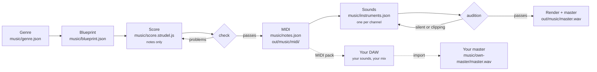

# The music engine

Every piece Mortiflix Music makes goes through one engine: Strudel writes the notes, the engine checks them and turns
them into MIDI, a sound is chosen for every MIDI channel, and the piece is rendered and mastered, or **finished by
you in your own DAW from the MIDI**. Every stage leaves a file you can read, and the engine writes down every
decision and every measurement in `music/MUSIC-SHEET.md`.

The method: the genre researched first, the piece planned in words, notes before sounds, and a machine that checks
each stage before the next one starts.

## The stages



| Stage | Who writes it | What the engine checks | What it leaves |
|---|---|---|---|
| **Genre** | the session, from 5+ sources it read | every field, a hook and a beat element, concrete "how"s | `music/genre.json`, `GENRE.md` |
| **Blueprint** | the session | sections contiguous with a function and an intensity (0–10), the chord chart, one MIDI channel per part, the genre signature, the length | `music/blueprint.json`, `BLUEPRINT.md` |
| **Score** | the session, in Strudel | every note against the chord of the moment (the harmony lock), each section's measured busyness against its asked intensity, nothing past the end, every part playing; in a loop kit, no note over a loop point | `music/check.json` |
| **MIDI** | captured from the score | (it's captured only once the score passes) | `music/notes.json`, `out/music/midi/`, `midi.zip` |
| **Sounds** | the session, from each channel's real range | every channel covered, two parts in one register never share a timbre, at most one lo-fi sound, low end and top covered, every drum number has a sound | `music/instruments.json` |
| **Audition** | the engine | each sound plays its part's lowest, middle and highest note: none silent, none clipping | `out/music/audition/*.wav` |
| **Master** | the engine | no stem silent or clipping alone; the balance (low end, mud, stereo width); -14 LUFS, true peak ≤ -1 dBTP | `out/music/master.wav`, `.mp3`, `stems/` |
| **Your master** | you, in your DAW | its length against the score; whether it starts at bar 1 (its first sound against the MIDI's first note) | `music/own-master/` |

## The MIDI pack

```
out/music/midi/
  <title>-all.mid        the whole arrangement: one track per channel, tempo, meter, section names as markers
  NN-<part>.mid          each channel on its own
  sections/
    NN-<section>/        a clip per section, its notes moved to start at the section's own bar 1:
      <section>-all.mid    every channel together
      NN-<part>.mid        each channel alone
  CUE-SHEET.md           tempo, key, length, the sections, each channel's role and range, the chord chart,
                         and the steps to bring it into your DAW
out/music/midi.zip       all of it, as one file
```

The clips are what makes the pack useful in a DAW: drop the chorus's drums onto a track, loop the breakdown's pad,
rebuild the arrangement your way. Drums are on channel 10 as General MIDI numbers (36 kick, 38 snare, 42 closed hat,
46 open hat, 49 crash), so they land on any drum rack.

Get it from the project page (**MIDI › Download MIDI**) or `mortiflix-music midi <project> [--out pack.zip]`.

## Notes first, sounds second

The score holds only music: pitches, rhythm, velocity and structure, each part on its own MIDI channel. It never says
what anything sounds like:

```js
// music/score.strudel.js: one cycle is one bar
setcpm(96 / 4)
const cue = (p) => p.filterWhen((t) => t < 8)
sub:   cue(note("<a1 f1 c2 g1>").velocity(.8)).midichan(1)
hook:  cue(note("<[e5 c5 a4 c5] [c5 a4 f5 a4] ...>").velocity("<.7 .85>").mask("<0!4 1!4>")).midichan(3)
drums: cue(note("[36 ~ ~ 36 38 ~ 36 ~], [42*8]").mask("<0!4 1!4>")).midichan(10)   // General MIDI drum numbers
```

```jsonc
// music/instruments.json: what each channel sounds like, and why
{ "concept": "A pure sub under a glassy FM bell; a dry synth kit.",
  "parts": [
    { "channel": 1, "role": "Sub", "sound": "sine", "set": ".lpf(300).release(.3)", "gain": 0.8, "pan": 0, "character": "dark", "why": "a clean floor" },
    { "channel": 3, "role": "Glass hook", "sound": "sine", "set": ".fm(3).fmh(3.5).decay(.4).sustain(.2)", "gain": 0.3, "pan": 0.35, "character": "bright", "why": "glass" },
    { "channel": 10, "role": "Drums", "gain": 0.9, "why": "dry and close",
      "kit": { "36": { "sound": "sine", "set": ".penv(24).decay(.2).sustain(0)" }, "38": { "sound": "pink", "set": ".decay(.12).sustain(0)" },
               "42": { "sound": "white", "set": ".hpf(7000).decay(.03).sustain(0)", "gain": 0.25 } } } ] }
```

When the engine renders, it adds the sounds as one layer on top of the score: it splits the score by channel, gives
each its sound, level, pan and its own effects bus, and stacks them again. A sound can never change a note, so the
MIDI you take into a DAW is exactly what Strudel played.

Sounds are Strudel's built-in synths (sine, triangle, square, sawtooth, supersaw, pulse, and noise), shaped with
filters, envelopes, FM and effects: nothing to download and no licence questions. A sample or soundfont is used only
with a `source` that names its licence, and only when that licence allows your use.

## The pipelines

- **`song`**: two reviews, the blueprint and the finished song (the master, the arrangement as a piano roll, the music
  sheet, the stems, the MIDI). The brief's "Who finishes it" can hand the final sound to you: the song is then
  reviewed with sketch sounds, and once it's approved the project waits for your master (**MIDI › Import your
  master**, or `mortiflix-music music <project> --import master.wav`). The studio checks it fits the score.
- **`midi-pack`**: two reviews, the blueprint and the MIDI. Sketch sounds make it audible, but the MIDI is the
  deliverable. Bring a `.mid` of yours (a progression, a riff, a beat) and the piece is built around it, note for
  note.
- **`loop-kit`**: two reviews, the kit plan and the loops. The blueprint sets `"loops": true`: every section is a loop,
  and the check refuses a note that rings past its loop's end or a loop with nothing in it, and warns on lengths that
  aren't 1, 2, 4, 8 or 16 bars. The clips in `sections/` are the kit.

## The music sheet

`music/MUSIC-SHEET.md` is rewritten after every stage. It's the engine's own account of the piece:

```
✔ Genre researched · ✔ Blueprint · ✔ Score checked · ✔ MIDI captured · ✔ Instruments chosen · ✔ Audition · ✔ Mastered (Strudel)

| Ch | Part       | Role   | Plays       | Notes | Instrument                     | Level / pan | Audition | Why this sound |
|----|------------|--------|-------------|-------|--------------------------------|-------------|----------|----------------|
| 1  | Sub        | bass   | F1–C2       | 8     | sine.lpf(300).release(.3)      | 0.8 / 0     | ✔        | a clean floor  |
| 3  | Glass hook | melody | G4–G5       | 16    | sine.fm(3).fmh(3.5)…           | 0.3 / 0.35  | ✔        | glass          |
| 10 | Drums      | drums  | GM 36 38 42 | 48    | 36: sine, 38: pink, 42: white  | 0.9 / 0     | ✔        | dry and close  |
```

## Running the engine by hand

The engine works on any folder with a `music/` directory, no studio needed:

```sh
export MFX_STRUDEL=~/MortiflixMusic/tools/strudel MFX_CHROME=$(command -v google-chrome-stable) MFX_DAW=ableton
M=pipelines/_shared/skills/music/strudel.mjs
node $M genre          # check music/genre.json
node $M plan           # check music/blueprint.json, write BLUEPRINT.md
node $M check          # the score: harmony, curve, clean loops; captures the MIDI and its clips when it passes
node $M instruments    # each channel's range and the sounds; checks music/instruments.json
node $M audition       # every sound across its part's range
node $M render --stems # a render with the sounds, without mastering (a sketch)
node $M master         # render, stems, balance, -14 LUFS master
node $M own-master     # an imported master: there, and does it fit?
node $M midi           # out/music/midi/ again
node $M sheet          # rewrite music/MUSIC-SHEET.md
```

Each command exits 1 with the problems in plain words until its stage is right. The method, stage by stage, is in
`pipelines/_shared/skills/music/SKILL.md`; the craft guides (genre research, melody, the harmony lock, voicing) are in
its `craft/` folder.
